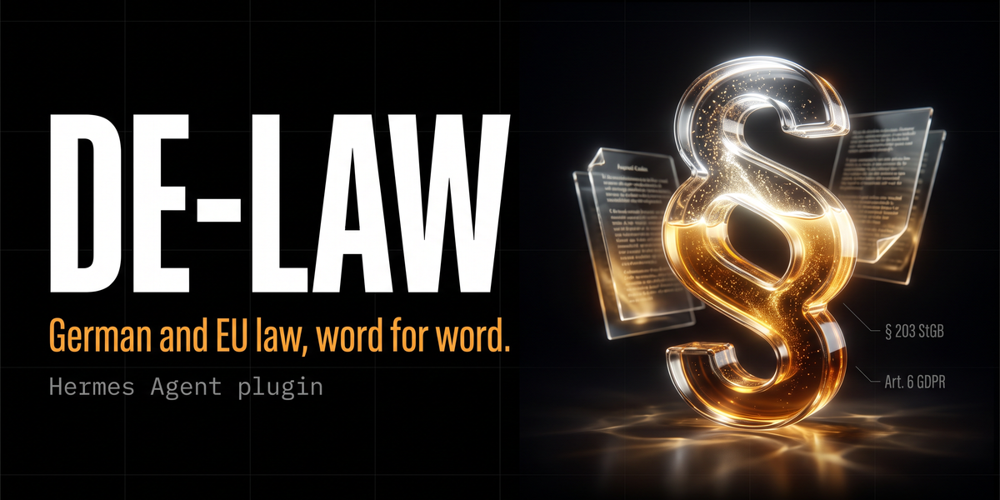

# de-law: German and EU law for Hermes Agent



Ask Hermes for `§ 203 StGB`, `Art. 6 Abs. 1 lit. f DSGVO` or `Art. 50 AI Act` and it reads the provision from the official source before it answers: the wording, the law's version status (Stand), the gazette reference, a link to the source page and a ready-made attribution line. It also searches the index of all German federal laws, lists the sections of a law, and finds and reads published decisions of the German federal courts.

Sources: [Gesetze im Internet](https://www.gesetze-im-internet.de) and [Rechtsprechung im Internet](https://www.rechtsprechung-im-internet.de) (German Federal Ministry of Justice, edited by the Federal Office of Justice) and the [Publications Office of the European Union](https://op.europa.eu) (CELLAR, the data behind EUR-Lex). No API key, no account.

> **Legal texts, not legal advice.** The plugin returns statute and court texts. It does not interpret them and does not replace a lawyer. The texts are the consolidated versions from the official databases; only the Bundesgesetzblatt and the Official Journal of the EU are legally binding.

## Who it is for

- **Anyone who asks Hermes about German or EU law** and wants the actual wording with a source instead of a quote from memory: founders, compliance and data protection officers, HR teams, consultants, journalists, students, and developers building on Hermes.
- **Lawyers and legal teams, as a starting point.** It addresses a known weakness of AI assistants in legal work: provisions quoted from memory, wrongly or in an outdated version. It is not a complete legal research system: no commentary, no historical versions, no state law, no lower courts, and no knowledge of your own firm.

## Beyond this plugin

de-law is free and stays free. If you want Hermes as part of the daily work of a firm, the next steps are not in a public plugin, because they depend on your own data and tools:

- a private knowledge base for briefs, templates and matters, running on your own server, with a protected mode for confidential material;
- a citation check for drafts: every § and file number is compared with the source text before a document leaves the firm;
- connections to the systems you already use (mail, documents, calendar) and further sources, checked one by one for their terms of use.

[MadeByBrain](https://madebybrain.com), the maintainer of this plugin, plans and builds such Hermes setups for businesses. If that is what you are looking for, get in touch through the website.

## What you can ask

- "Was steht in § 203 Abs. 1 StGB? Wortlaut mit Quelle und Stand."
- "Zitiere § 43e Abs. 3 BRAO."
- "Welcher Paragraph im BGB regelt das Widerrufsrecht bei Fernabsatzverträgen?"
- "Quote Article 50(1) of the EU AI Act with the version date."
- "Erwägungsgrund 47 DSGVO" or "Anhang III KI-VO"
- "Was hat das Bundesverfassungsgericht in 2 BvE 5/26 entschieden? Nur Tenor."

## Install

```bash
hermes plugins install MadeByBrain/hermes-de-law --enable
```

To install one exact version, pin the commit (the `--ref` option takes a full 40-character commit SHA, not a tag; every GitHub release lists its SHA):

```bash
hermes plugins install MadeByBrain/hermes-de-law --ref <commit-sha> --enable
```

Requires Hermes Agent v0.22.2 or newer. No Python dependencies (standard library only).

## Tools

| Tool | What it does |
|---|---|
| `de_law_get` | One section or article in full text, optionally one paragraph (Absatz). German federal law and EU regulations and directives through the same call. |
| `de_law_search` | Find a law by abbreviation or title words (about 6,100 federal laws and ordinances, plus a list of well-known EU acts). |
| `de_law_toc` | Table of contents of one law, optionally filtered by a word in a heading or in the text, with a snippet. |
| `de_case_search` | Find decisions of BVerfG, BGH, BVerwG, BFH, BAG, BSG and BPatG by file number (Aktenzeichen), court and date range. |
| `de_case_get` | One decision: court, date, file number, ECLI, cited norms, and the parts you ask for (headnote, operative part, facts, reasons, grounds, dissent). |

Hermes lists plugin tools through Tool Search. The plugin also registers a small skill (`de-law:read-law`) that tells the model to use these tools before a web search and to quote the source line.

### Ways to write a citation

`§ 203 StGB`, `StGB § 203`, `203 StGB`, `§§ 43e BRAO`, `§ 43e Abs. 3 Satz 1 BRAO`, `§ 203 Abs. 1 Nr. 3 StGB`, `Art. 1 GG`, `Artikel 1 GG`, `Art. 6 Abs. 1 lit. f DSGVO`, `Art. 6(1)(f) GDPR`, `Article 5(1)(a) of the GDPR`, `Erwägungsgrund 47 DSGVO`, `Recital 47 GDPR`, `Anhang III KI-VO`, `Annex III AI Act`, `Anlage 1 BRAO`, `§ 1 des Bürgerlichen Gesetzbuchs`.

A law can be named by its official abbreviation (`StGB`, `BDSG`, `AO`), by its title, by its folder name on Gesetze im Internet (`bdsg_2018`) or, for EU law, by a short name (`DSGVO`, `GDPR`, `KI-VO`, `AI Act`, `DSA`, `DMA`, `NIS2`, `DORA`, `Data Act`, `DGA`, `eIDAS`, `MiCA`, `CRA`, `CSRD`, `CSDDD`, `Rom I`, `Brüssel Ia`, `EAA`, `Whistleblower-RL`, `ProdHaft-RL`), a CELEX number (`32016R0679`) or its number (`Verordnung (EU) 2016/679`, `Richtlinie (EU) 2022/2555`, `Regulation (EC) No 593/2008`).

With `Abs.` the tool returns only that paragraph. `Satz`, `Nr.` and `lit.` are reported back as a pinpoint; the text returned is the whole paragraph that contains them.

### What comes back

`de_law_get` for `{"citation": "§ 43e Abs. 3 BRAO"}` (real result of 24.10.2026, `structure` shortened):

```json
{
  "ok": true,
  "jurisdiction": "DE",
  "paragraph": "3",
  "law": {"abbreviation": "BRAO", "title": "Bundesrechtsanwaltsordnung", "id": "brao",
          "enacted": "1959-08-01", "gazette": ["BGBl I 1959, 565"],
          "url": "https://www.gesetze-im-internet.de/brao/index.html"},
  "provision": {
    "citation": "§ 43e Abs. 3 BRAO",
    "id": "§ 43e",
    "title": "Inanspruchnahme von Dienstleistungen",
    "structure": ["Dritter Teil Rechte und Pflichten des Rechtsanwalts ...", "Erster Abschnitt Allgemeines"],
    "text": "(3) Der Vertrag mit dem Dienstleister bedarf der Textform. In ihm ist\n1. der Dienstleister unter Belehrung über die strafrechtlichen Folgen einer Pflichtverletzung zur Verschwiegenheit zu verpflichten,\n2. ...",
    "truncated": false
  },
  "version": {
    "status": [{"type": "Stand", "text": "Zuletzt geändert durch Art. 4 G v. 22.12.2025 I Nr. 349"}],
    "data_as_of": "2026-05-06",
    "note": "The status line (Stand) belongs to the whole law, not only to this provision."
  },
  "source": {
    "name": "Gesetze im Internet",
    "url": "https://www.gesetze-im-internet.de/brao/__43e.html",
    "data_as_of": "2026-05-06",
    "retrieved_at": "2026-10-24T16:18:06Z",
    "cache": "cached",
    "attribution": "Quelle: Gesetze im Internet (www.gesetze-im-internet.de), Bundesministerium der Justiz und für Verbraucherschutz, Redaktion Bundesamt für Justiz. Konsolidierte Fassung, Datenstand 06.05.2026, abgerufen am 24.10.2026, Auszug erstellt mit hermes-de-law. Verbindlich ist allein die im Bundesgesetzblatt verkündete Fassung."
  }
}
```

For EU law, `version` names the document read (`02016R0679-20160504`), `consolidated_as_of`, the Official Journal reference, the amending acts and corrigenda listed in the consolidated text, and its own legal notice ("Dieser Text dient lediglich zu Informationszwecken und hat keine Rechtswirkung ..."). The plugin reads the newest consolidated version whose date is not in the future. Recitals are read from the original Official Journal text, because consolidated texts leave them out.

`source.cache` says where the text came from: `fresh` (just downloaded), `cached` (local copy younger than `max_age_hours`), `revalidated` (the source confirmed the local copy is current), `stale` (the source could not be reached, so the last local copy is returned with `stale: true` and its date).

### When something goes wrong

Tools never raise. A failure is a JSON object with `ok: false`, `error`, `error_type` and usually a `next_step` for the model.

| `error_type` | Example | `next_step` says |
|---|---|---|
| `section_not_found` | `§ 9999 BGB` | do not guess a nearby number; list the law with `de_law_toc` |
| `paragraph_not_found` | `§ 203 Abs. 9 StGB` | which paragraphs exist |
| `article_not_found` | `Art. 120 DSGVO` | how many articles the document has |
| `law_not_found` | `BayDSG` (state law) | search with other words; state law is not covered |
| `ambiguous_law`, `ambiguous_case` | a title word that fits several laws, a file number with several decisions | pick one of the listed candidates |
| `not_covered` | `Richtlinie 2002/58/EG` (no structured text) | give the user the EUR-Lex link instead |
| `disabled` | EU law or case law switched off in the settings | |
| `bad_argument` | no law, no number, a malformed date | how to call it |
| `network`, `timeout`, `upstream`, `bad_response`, `too_large` | source unreachable or changed | retry once, later |
| `internal` | a bug in the plugin | retry once, then link the source site |

## Settings

Under `plugins.entries.de-law.settings` in `config.yaml`, or in the Desktop app under Settings, Plugins:

| Key | Default | Meaning |
|---|---|---|
| `language` | `auto` | Language of the attribution line: `auto` (the language of the text, German for German law), `en`, `de`. |
| `eu_language` | `de` | Default language for EU acts (`de` or `en`); the model can ask for the other one per call. German federal law exists in German only. |
| `max_age_hours` | `24` | Cached laws and indexes older than this are rechecked with the source. `0` = always recheck. |
| `cache_max_mb` | `200` | When the cache grows beyond this, the least recently used entries are deleted. |
| `case_law` | `true` | Allow `de_case_search` and `de_case_get`. |
| `eu_law` | `true` | Allow EU acts. |

## Network, data and privacy

- **Three hosts, HTTPS only:** `www.gesetze-im-internet.de`, `www.rechtsprechung-im-internet.de`, `publications.europa.eu`. Redirects are followed only to these hosts; a redirect to plain HTTP on the same host is upgraded to HTTPS. EUR-Lex itself is not contacted.
- **What is sent:** for German law, the folder name of the law (`/stgb/xml.zip`), the daily index and, once a week, the alphabetical abbreviation list for one letter. The section number and your search words are **not** sent: the plugin downloads the whole law and picks the section locally. For EU law, the CELEX number and the language (`Accept-Language: deu` or `eng`), plus one query to the Publications Office SPARQL endpoint that lists the consolidated versions of that act. For case law, the daily index and the document id of the decision you read. Search and table-of-contents filtering run locally.
- **What is stored:** public legal texts and indexes, as JSON, under `<HERMES_HOME>/plugin-data/de-law/cache/` (with ETag and Last-Modified for cheap rechecks). No questions, no session data, no user data. The cache is capped by `cache_max_mb`; delete the folder at any time.
- **What is read:** only the plugin's own settings, through Hermes's plugin settings API.
- **No credentials, no hooks, no cron jobs, no background processes, no shell commands, no telemetry, no self-updates.** Python's `urllib` honours the system proxy settings (`HTTPS_PROXY`).
- **Gentle on public servers:** at most one request per second per host, each with a 25-second socket timeout and a response cap (40 MB; 80 MB for the unpacked case-law index, which is about 23 MB). A cold `de_law_get` makes up to three requests for German law and up to four for EU law; a warm one makes none.
- **Tools on every platform:** the five tools are available wherever the plugin is enabled, including messaging gateways (a guest a gateway admits can call them; `hermes tools` disables them per platform). While the plugin is enabled, its skill adds one line to the skills index of every session.

## Sources, terms and attribution

- **German federal law** comes from Gesetze im Internet (publisher: German Federal Ministry of Justice and Consumer Protection; editor: Federal Office of Justice). Its notes page offers the XML downloads for automated processing and explicitly allows deep links. Statutes are official works without copyright under § 5 of the German Copyright Act. The texts are consolidated by the Federal Office of Justice; the binding version is the one promulgated in the Bundesgesetzblatt. Every result carries a source line with the data date.
- **Court decisions** come from Rechtsprechung im Internet (same publisher and editor). Its notes page offers the XML for automated processing; decisions are official works under § 5 of the German Copyright Act, and the decision documents checked carry `accessRights: public`. The server sends the HTTP header `tdm-reservation: 1` (a text and data mining reservation) on every response. This plugin fetches the index and single decisions on request only and does not mine or bulk-download the collection. Turn case law off with `case_law: false` if your use requires it.
- **EU law** comes from the Publications Office of the European Union. Its copyright notice licenses EU-owned content under CC BY 4.0: acknowledge the source and indicate changes. Every result names the source, the license, the document (CELEX) and that the plugin extracted the article and converted it to plain text (consolidation markers such as ►M1 are removed). Consolidated texts have no legal effect; only the Official Journal is authentic.

## Limitations

- **Coverage:** German federal law only. State law (Landesrecht), administrative regulations, the EU treaties (TEU, TFEU, Charter) and EU acts without ELI-structured text (many acts from before about 2013, for example Directive 2002/58/EC) are not covered; the tool says so and gives the EUR-Lex link.
- **Version:** the current consolidated text only. No historical versions, no pending amendments. The Stand line applies to the whole law; a later amendment that is not yet in force is not shown.
- **Pinpoints:** `Satz`, `Nr.` and `lit.` are not cut out; the whole paragraph is returned.
- **Tables** inside a provision are flattened to one line per row with ` | ` between cells.
- **Case law:** only what the federal government publishes on Rechtsprechung im Internet (about 85,000 decisions on 24.10.2026). Lower courts are not included. Searching is by file number, court and date, not by full text.
- **Gesetze im Internet** sometimes lists a provision with its heading only; then `text` is empty and a `note` says so. Repealed provisions (`weggefallen`) are reported as `repealed: true`.
- If a source changes its format, the plugin returns an error rather than wrong text; the fix is a new release.

## Development

```bash
python -m unittest discover -s tests -v     # 35 offline tests, no network
hermes plugins validate . --install-deps     # the check the Hermes plugin catalog runs
```

The offline tests use small fixtures in the sources' formats (zipped at run time, no binary files in the repo) and a fake transport; they cover citation parsing, XML and XHTML conversion, cache states (fresh, cached, revalidated, stale), host allowlist and redirects, size caps, settings, error paths and that the registered tools match `plugin.yaml`.

## How this was checked

On 24.10.2026, Hermes Agent v0.22.2 (CLI), Python 3.11, in an isolated `HERMES_HOME` with `google/gemini-3.7-flash` via OpenRouter: real questions about § 203 StGB, § 312g BGB, § 43e BRAO, Art. 6 DSGVO, Art. 50 AI Act (English) and BVerfG 2 BvE 5/26 were answered from the tool results with source line and version; a state law question returned `law_not_found`; `§ 9999 BGB` returned `section_not_found`. Every CELEX number in the EU list was checked against the Publications Office (title and structured text). Not tested live: WebUI, Desktop app, messaging gateways (same tool code path, but untested), other models.

## Auf Deutsch

`de-law` holt Paragraphen und Artikel aus den offiziellen Datenbanken: Bundesrecht von Gesetze im Internet, Entscheidungen der Bundesgerichte von Rechtsprechung im Internet, EU-Recht vom Amt für Veröffentlichungen der EU. Jede Antwort enthält Wortlaut, Stand, Fundstelle, Link und eine fertige Quellenzeile. Paragraph und Suchbegriffe verlassen den Rechner nicht, weil das Plugin das ganze Gesetz lädt und lokal zwischenspeichert. Das Plugin liefert Gesetzestexte, keine Rechtsberatung. Verbindlich sind nur Bundesgesetzblatt und Amtsblatt der EU.

## License

MIT. See [LICENSE](LICENSE). Built by [MadeByBrain](https://madebybrain.com).
